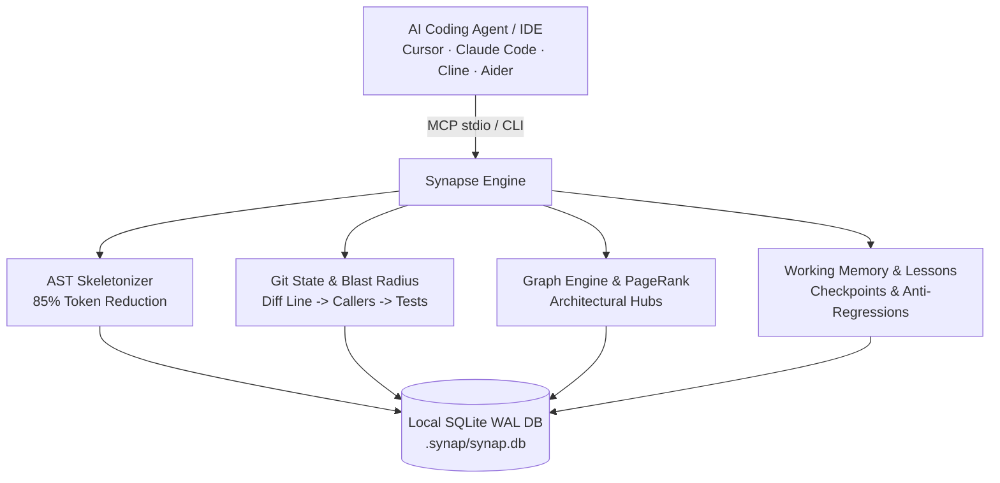

# Synapse

> Fast, local, zero-cost structural context engine for AI coding agents.

[](https://github.com/saahilpal/synapse/actions)
[](https://pypi.org/project/synap-git/)
[](https://pypi.org/project/synap-git/)
[](LICENSE.md)

---

## ⚡ 5-Second Quickstart

Install Synapse and automatically configure your IDE (Cursor, Claude Code, Cline, Windsurf):

```bash
pip install synap-git
synap install
```

Done. Synapse indexes your repository with Tree-sitter, installs zero-daemon Git hooks for automatic reindexing, and registers MCP server endpoints.

---

## Why Synapse?

| Feature | Synapse | Repomix | Aider | Cursor / Cline Default |
| :--- | :---: | :---: | :---: | :---: |
| **API Cost** | **100% Free (Zero)** | 100% Free | Burns Tokens | Cloud Token Usage |
| **Graph Intelligence** | **AST Symbol & Edge Graph** | None (Flat Dump) | Repo Map (CTags) | Vector Embeddings |
| **Code Skeletonization** | **85% Token Reduction** | None (Raw Code) | Line Truncation | Chunk Slicing |
| **Git Blast Radius** | **Instant Callers & Tests** | None | Diff Only | None |
| **Architectural Hubs** | **Personalized PageRank** | None | Static Frequency | None |
| **Working Memory** | **Persistent Checkpoints** | None | Ephemeral Chat | Ephemeral Session |
| **Runtime Footprint** | **Zero-Daemon Hook Mode** | CLI Only | CLI Process | Background Indexer |

---

## Architecture



For database schemas and CTE traversal queries, see [Architecture Internals](docs/architecture.md).

---

## Essential CLI Commands

```bash
# Print token-bounded startup context (< 750 tokens)
synap context

# Check modified symbols, direct callers, and impacted tests
synap blast

# Run only tests impacted by dirty git blast radius
synap test

# Deep structural symbol inspection (callers, dependencies, tests)
synap explain my_function

# Export token-budgeted prompt pack with AST skeletons (< 8k tokens)
synap pack

# Inspect structural AST skeleton of any file (strips bodies, keeps types/docstrings)
synap skeleton src/my_module.py

# Discover top architectural hubs via PageRank
synap hubs

# Search repository with hybrid structural ranking
synap search "authentication flow"

# Verify environment and system health
synap doctor
```

Shorthand aliases supported: `synap ctx`, `synap blast`, `synap t`, `synap ex <sym>`, `synap sk <file>`, `synap hubs`, `synap doc`.

---

## MCP Tools for AI Agents

When registered via `synap install`, AI agents gain direct access to these MCP tools:

| MCP Tool | Purpose |
| :--- | :--- |
| `get_session_preamble()` | Token-optimized session startup context (< 750 tokens: active branch, dirty files, blast radius, hubs, lessons). |
| `get_skeleton(file_path)` | Extracts function signatures, types, and docstrings without function bodies (85% token savings). |
| `get_blast_radius()` | Computes impact radius of uncommitted git changes down to callers and test files. |
| `get_callers(symbol)` | Finds all functions and modules that call or depend upon a symbol. |
| `get_callees(symbol)` | Finds all functions and symbols called by a given symbol. |
| `read_symbol(symbol)` | Reads exact lines and code of a specific function or class without reading the entire file. |
| `get_diff()` | Unified git diff of uncommitted or staged changes. |
| `get_test_recommendations()` | Discovers impacted test suites and provides recommended `pytest` commands. |
| `create_checkpoint(doing)` | Saves thought process and dirty working state before complex refactors. |
| `restore_checkpoint(id)` | Restores past checkpoint context after agent context compaction or memory wipes. |
| `remember(key, content)` | Stores operational observations and environment facts in persistent memory. |

---

## License

MIT © Saahil Pal
